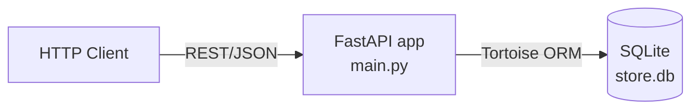
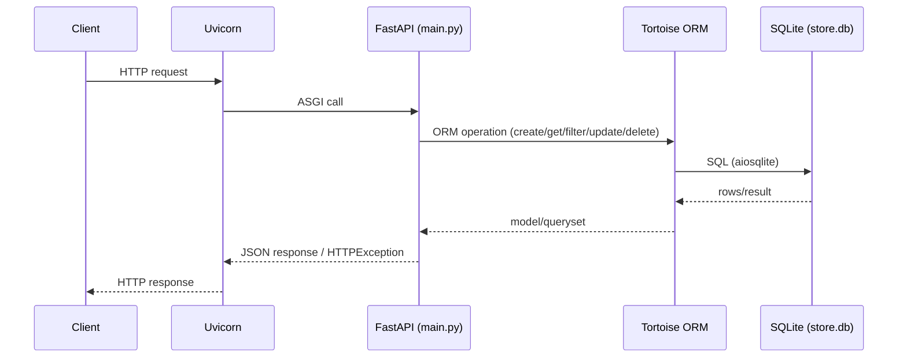
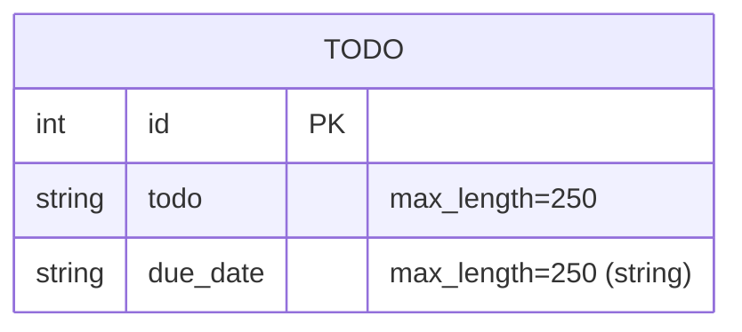

# Architecture — FastAPI

> Phase 3 audit artifact (docs only). Derived from real code at commit `7f9acb5` on `phase-3/audit-plan` (worktree). Unconfirmed items are labeled.

## 1. Purpose and scope
A minimal FastAPI service exposing a Todo CRUD REST API backed by SQLite via Tortoise ORM. Intended as a demo/learning project; no production SLOs, auth, or external integrations are defined in-repo.

## 2. System context

- **Inbound:** HTTP requests to Uvicorn-served ASGI app.
- **Outbound/storage:** local SQLite file only. No message brokers, caches, or third-party APIs observed.

## 3. Component / module view
| Component | Path | Responsibility |
|-----------|------|----------------|
| API/router | `main.py` | App creation, route handlers (`/`, `/todo`, `/todo/{id}`), request/response wiring, Tortoise registration |
| Domain/data model | `models.py` | `Todo` ORM model and generated Pydantic schemas (`Todo_Pydantic`, `TodoIn_Pydantic`) |
| Persistence | `store.db` (+ WAL/SHM) | SQLite storage (committed in repo) |
| Dev bootstrap | `.gitpod.yml`, `command_line.md` | Ad-hoc environment/install/run instructions |
| Docs | `README.md` | Usage/endpoints overview |

No additional packages, services, or layered modules exist.

## 4. Runtime and request flow

- **Startup/registration:** `register_tortoise(app, db_url="sqlite://store.db", modules={'models':['models']}, generate_schemas=True, add_exception_handlers=True)` executed at module scope in `main.py` (side effect on import/start).

## 5. Data model

- `due_date` is a free-form string (no date type/validation enforced in model).
- Schemas generated by `pydantic_model_creator` (Pydantic v1-era usage via FastAPI 0.75/Tortoise integration as installed).

## 6. API surface (observed)
| Method | Path | Behavior |
|--------|------|----------|
| GET | `/` | Health-like response `{"hello":"world"}` |
| POST | `/todo` | Create Todo, returns `Todo_Pydantic` |
| GET | `/todo/{id}` | Fetch Todo, 404 modeled |
| PUT | `/todo/{id}` | Update fields (exclude unset), returns updated Todo |
| DELETE | `/todo/{id}` | Delete Todo, returns message or 404 |

OpenAPI/Swagger UI auto-generated by FastAPI (README references `/redocs`/`/redoc`; FastAPI defaults are `/docs` and `/redoc` — **unconfirmed** at runtime in this audit).

## 7. Configuration and environment
- **DB URL:** hardcoded `sqlite://store.db` in `main.py`.
- **Env vars / secrets:** none referenced in code. `.env.example` absent.
- **Ports:** not pinned in code; uvicorn defaults apply when run via documented commands.

## 8. Cross-cutting concerns (current state)
- **AuthN/AuthZ:** none.
- **Validation:** basic Pydantic/ORM field constraints; limited domain validation.
- **Error handling:** FastAPI/HTTPException + Tortoise exception handlers.
- **Logging/metrics/tracing:** none custom.
- **Health:** only `GET /` (no liveness/readiness split).

## 9. Deployment / operations shape
- No Dockerfile, compose, Makefile, or CI workflows. Local/dev execution via uvicorn per README/command_line/.gitpod.
- Database lifecycle tied to local file and `generate_schemas=True`.

## 10. Constraints and notable gaps (feeds roadmap)
- Non-reproducible deps (no manifest/lock), EOL-era stack (Python 3.8, FastAPI 0.75, Pydantic v1), committed DB artifacts, no tests/CI, no container baseline. See `REPOSITORY_AUDIT.md`, `TECHNICAL_DEBT.md`, `IMPROVEMENT_ROADMAP.md`.